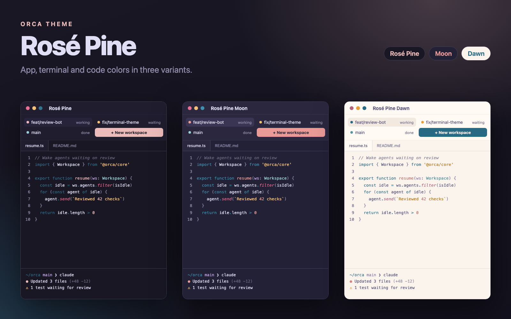

# Rosé Pine for Orca

All natural pine, faux fur and a bit of soho vibes, in [Orca](https://www.onorca.dev). This
plugin brings the three [Rosé Pine](https://rosepinetheme.com) variants to Orca's app, terminal
and code editor:

| Theme | Base | Use it for |
| --- | --- | --- |
| Rosé Pine | dark | the original |
| Rosé Pine Moon | dark | a softer, bluer night |
| Rosé Pine Dawn | light | daytime |

## Install

In Orca, open **Settings → Plugins**, search for **Rosé Pine** and choose **Install**. Then pick
the themes:

- **Settings → Appearance → Theme**: choose Rosé Pine or Rosé Pine Moon as the dark theme and
  Rosé Pine Dawn as the light theme. Orca switches between them with your system.
- **Settings → Appearance → Terminal**: choose the matching terminal theme.

The app themes also color the code editor, using the roles of Rosé Pine's own VS Code theme:
pine keywords, gold strings, foam types, iris parameters and muted italic comments.

## Notes

- Orca hides any code color under 3:1 contrast and any text color under 4.5:1. To keep every
  color, a few sit slightly darker than the palette: in Dawn, gold, rose and muted in code and
  subtle text in the interface; in Moon, subtle text is slightly lighter. Everything else is the
  exact palette.
- Dawn's buttons use pine instead of rose, because text on Dawn's rose is not readable enough.
- Requires Orca 1.4.246 or later.

## Develop

The theme files are generated. Edit `scripts/build.mjs`, then run `node scripts/build.mjs`; it
rewrites `themes/` and `terminal/` and fails if any color would be dropped for low contrast.

## Credits

The palette and the syntax roles come from [rose-pine/palette](https://github.com/rose-pine/palette)
and [rose-pine/vscode](https://github.com/rose-pine/vscode), both MIT. This is a community port,
not made by the Rosé Pine team.

MIT licensed. See [LICENSE](LICENSE).
